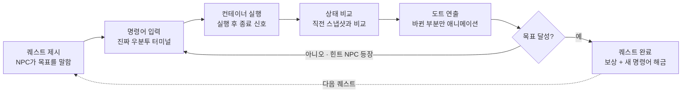
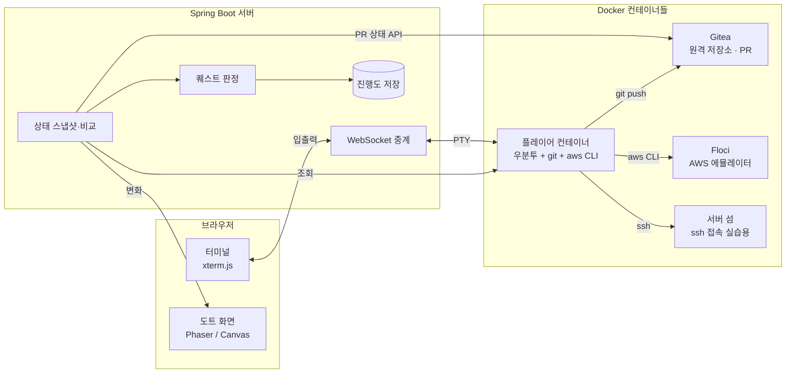

# DotShell — 터미널 명령어 학습 도트 게임 기획서

2026-11-26 · 종민

## 게임 제목

메인 제목은 **DotShell (도트쉘)** 을 추천합니다. 도트(pixel dot) + 셸(shell)이라 "명령어를 치면 도트 세계가 움직인다"는 핵심이 이름에 다 들어 있습니다.

**한 줄 소개:** 진짜 우분투 터미널에 명령어를 치면, 그 결과가 도트 세계에서 그대로 벌어지는 학습 게임.

| 후보         | 느낌                          | 쓰임                  |
|--------------|-------------------------------|-----------------------|
| **DotShell** | 도트 + 셸, 짧고 기억하기 쉬움 | 게임 전체 제목 (추천) |
| cd 던전      | 디렉터리 = 던전의 방          | 리눅스 기초 챕터 이름 |
| Git Out!     | git + "나가!" 말장난          | Git 챕터 이름         |
| sudo 퀘스트  | 권한 상승 = 레벨업            | 권한·패키지 챕터 이름 |
| Root Quest   | root가 되는 것이 최종 목표    | 대체 전체 제목        |

전체 제목은 DotShell로 두고, 나머지는 챕터 이름으로 쓰면 세계관이 풍성해집니다.

## 기획 의도와 목표

1순위는 진짜 명령어를 손에 익히는 것이고, 2순위는 백엔드 포트폴리오로 쓸 수 있는 구조를 만드는 것입니다.

- **학습 범위:** 우분투 기본 명령어·권한·패키지·프로세스, Git 로컬(commit, branch, merge)과 원격(push, pull, PR), AWS CLI(S3, EC2, IAM)

- **핵심 원칙:** 게임용 가짜 명령어가 아니라 실제 명령어를 그대로 칩니다. 게임 밖 실무 터미널에서도 똑같이 통해야 의미가 있습니다.

- **시각화:** 머릿속으로만 그리던 것(파일 트리, Git 브랜치 구조, 원격 저장소)을 도트 장면으로 보여줍니다.

- **포트폴리오:** WebSocket 실시간 통신, 플레이어별 Docker 컨테이너 관리, 상태 검증 엔진은 백엔드 면접에서 설명하기 좋은 주제입니다.

## 세계관과 핵심 메타포

파일 시스템이 곧 지도이고, 명령어는 주인공이 쓰는 행동입니다. 플레이어는 망가진 "서버 왕국"에 배치된 견습 관리자이고, 명령어로 왕국을 복구하며 최종적으로 root 권한을 얻는 것이 목표입니다.

| 명령어                      | 도트 화면에서 일어나는 일                                                         |
|-----------------------------|-----------------------------------------------------------------------------------|
| pwd                         | 캐릭터 머리 위에 현재 위치 표지판                                                 |
| ls / ls -a                  | 방 안의 물건(파일)과 문(디렉터리)이 드러남 / 숨겨진 아이템(.파일)이 반짝이며 등장 |
| cd                          | 문을 지나 다른 방으로 이동, cd ..은 뒷문                                          |
| mkdir / touch               | 벽돌이 쌓이며 새 방 생성 / 빈 상자 등장                                           |
| cat                         | 두루마리를 펼쳐 내용 읽기                                                         |
| cp / mv                     | 물건 복제 / 들고 옮기기                                                           |
| rm                          | 물건이 픽셀로 부서져 사라짐 (rm -rf는 폭발 경고 연출)                             |
| chmod / sudo                | 상자에 자물쇠 / 왕의 인장으로 잠긴 문 열기                                        |
| apt install                 | 상인 NPC에게서 도구 구매                                                          |
| grep / \|                   | 돋보기로 단어 찾기 / 기계 두 대가 진짜 파이프로 연결                              |
| ps / kill                   | 돌아다니는 몬스터(프로세스) 목록 / 처치                                           |
| git add                     | 물건을 포장대(스테이징)에 올림                                                    |
| git commit                  | 세이브 포인트 — 화면 위 타임라인에 점 하나                                        |
| git branch / switch         | 타임라인이 갈라짐, 평행세계로 이동                                                |
| git merge                   | 두 세계가 합쳐짐, 충돌이면 물건 두 개가 부딪히는 연출                             |
| git push / pull             | 하늘 위 "원격 성"으로 짐을 보내고 받기                                            |
| PR                          | 성의 길드 게시판에 요청서 → 리뷰어 NPC가 검토 후 승인                             |
| aws s3                      | 구름 위 창고(버킷)에 물건 보관                                                    |
| aws ec2 run-instances / ssh | 구름 섬에 서버 골렘 소환 / 포탈로 그 섬에 이동                                    |
| IAM                         | 문지기에게 출입증 발급                                                            |

## 핵심 게임 루프



핵심 게임 루프 · 6단계, 판정 1번

목표 판정은 "열쇠 파일이 /dungeon/vault에 있는가"처럼 최종 상태로 합니다. 그래서 정답 명령어가 여러 개여도 모두 인정되고, 실패한 명령어(종료 코드가 0이 아님)는 그 자리에서 힌트로 이어집니다.

## 챕터 구성

챕터는 5개입니다. 앞 챕터에서 배운 명령어를 뒷 챕터에서 계속 쓰도록 쌓아 올립니다. 각 챕터는 튜토리얼 → 연습 스테이지 3~5개 → 보스 퀘스트 순서로 진행됩니다.

| 챕터            | 배경                      | 배우는 명령어                                               | 보스 퀘스트                                                    |
|-----------------|---------------------------|-------------------------------------------------------------|----------------------------------------------------------------|
| 1\. cd 던전     | 지하 던전 (파일 시스템)   | pwd ls cd mkdir touch cat cp mv rm find, 절대·상대 경로     | 꼬인 디렉터리 미로에서 열쇠 파일 찾기                          |
| 2\. sudo 퀘스트 | 성 내부 (권한·도구)       | chmod chown sudo apt grep \| \> \>\> ps kill                | 로그에서 에러를 grep으로 찾고 폭주 프로세스 처치               |
| 3\. Git Out!    | 시간의 탑 (Git 로컬)      | init status add commit log diff branch switch merge restore | 두 평행세계를 merge하며 충돌 해결                              |
| 4\. 원격 성     | 하늘의 성 (Git 원격·협업) | clone remote push pull fetch .gitignore, PR 생성·리뷰·머지  | 동료 NPC가 먼저 push해서 생긴 충돌을 pull → 해결 → PR로 머지   |
| 5\. 구름 왕국   | 구름 위 섬들 (AWS)        | aws configure aws s3 aws ec2 aws iam ssh                    | S3에 정적 사이트를 올리고, 서버 섬에 ssh로 들어가 nginx 띄우기 |

스토리와 별도로 **자유 모드(샌드박스)** 를 두면, 마음대로 명령어를 치며 도트 세계가 어떻게 변하는지 실험할 수 있습니다.

## 화면 구성

```
┌──────────────────────────────────────────────────────────────┐
│ Ch.1 cd 던전 · 스테이지 2/5          현재 위치 /home/hero/dungeon │
├────────────────────────────────────────┬─────────────────────┤
│ 도트 세계                              │ 퀘스트 · 힌트       │
│  캐릭터·방·물건이 명령어 결과대로 움직임 │ 목표: key를 vault로 │
│                                        │ 힌트 NPC 대사       │
│  [ home ]──[ dungeon ]──[ vault ]      │ 배운 명령어 카드    │
│                                        │ (Git: 커밋 타임라인)│
│                                        │ (AWS: 리소스 목록)  │
├────────────────────────────────────────┴─────────────────────┤
│ 터미널 (xterm.js)                                            │
│ hero@dotshell:~/dungeon$ mv key.txt vault/                   │
│ hero@dotshell:~/dungeon$ _                                   │
└──────────────────────────────────────────────────────────────┘
```

화면 구성 · 4개 영역

입력(터미널)과 결과(도트 세계)를 눈을 돌리지 않고 함께 보는 것이 핵심입니다. 오른쪽 패널은 챕터에 따라 퀘스트 목록, Git 커밋 타임라인, AWS 리소스 목록으로 바뀝니다.

## 기술 설계

브라우저 게임에 플레이어마다 진짜 우분투 Docker 컨테이너를 붙이는 방식(B)을 추천합니다. 진짜 명령어를 쓰면서도 내 PC는 안전하고, 백엔드 포트폴리오로 설명할 거리가 가장 많습니다.



시스템 구조 · 브라우저, 서버, 컨테이너

플레이어가 친 키는 WebSocket으로 컨테이너에 그대로 전달됩니다. 서버는 명령어가 끝날 때마다 상태만 읽어 도트 화면에 변화를 보내고, PR 상태처럼 컨테이너 밖 정보는 Gitea API로 읽습니다.

### 선택지 비교

| 방식                                    | 장점                                                            | 단점                                                               |
|-----------------------------------------|-----------------------------------------------------------------|--------------------------------------------------------------------|
| A. 가짜 셸 (JS로 명령어 흉내)           | 서버 불필요, 만들기 쉽고 시각화 제어가 자유로움                 | 구현 안 한 옵션은 안 됨, 실제와 다르게 익힐 위험, 백엔드 거리 적음 |
| **B. 진짜 셸 + Docker 컨테이너 (추천)** | 모든 명령어·옵션이 실제로 동작, rm -rf / 해도 컨테이너만 망가짐 | 서버와 컨테이너 관리가 필요해 난이도 중상                          |
| C. 내 PC 터미널을 그대로 감시           | 가장 실전적                                                     | 실수하면 내 PC가 망가짐, 배포·공유 어려움                          |

### 핵심 아이디어: 명령어를 해석하지 말고 "상태"를 비교한다

mkdir -p a/b/c, mv \*.txt docs/ 같은 명령어를 하나하나 파싱하면 끝이 없습니다. 대신 명령어가 끝날 때마다 컨테이너 상태를 찍어서 직전 상태와 비교하고, 달라진 부분만 도트로 그립니다.

- **파일 트리** (find 결과) → 생긴 방·사라진 물건·옮겨진 물건

- **현재 위치** (pwd) → 캐릭터 위치

- **Git 상태** (git log --all, 브랜치 목록) → 타임라인 그림

- **원격·PR 상태** (Gitea API) → 원격 성, 길드 게시판

- **AWS 상태** (aws s3 ls, aws ec2 describe-instances) → 구름 섬

명령어가 끝난 시점은 bash의 PROMPT_COMMAND(프롬프트가 뜨기 직전에 실행되는 훅)로 알아냅니다. 입력한 명령어 문자열은 연출에만 씁니다. 예를 들어 rm이면 부서지는 애니메이션, mv면 들고 가는 애니메이션을 고릅니다.

### 추천 스택

| 영역          | 기술                                                             | 이유                                                                  |
|---------------|------------------------------------------------------------------|-----------------------------------------------------------------------|
| 백엔드        | Java + Spring Boot, WebSocket                                    | 주언어이고 국비과정 스택과 같음                                       |
| 컨테이너 제어 | docker-java 라이브러리 + ubuntu 이미지                           | 플레이어 세션마다 컨테이너 생성·삭제                                  |
| 터미널 화면   | xterm.js                                                         | 브라우저에서 진짜 터미널처럼 입출력                                   |
| 도트 화면     | Phaser 또는 HTML Canvas                                          | 스프라이트 애니메이션                                                 |
| Git 원격·PR   | Gitea (Docker로 실행)                                            | 내 서버 안의 작은 GitHub. push·PR을 실제로 하고, API로 PR 상태를 읽음 |
| AWS           | [Floci](https://github.com/floci-io/floci) (무료 AWS 에뮬레이터) | 진짜 aws CLI 명령어를 그대로 쓰고 과금이 없음                         |
| ssh 실습      | 두 번째 우분투 컨테이너                                          | "서버 섬" 역할. ssh로 들어가 nginx 설치까지 실제로 가능               |

**AWS 에뮬레이터 주의:** 많이 쓰던 LocalStack은 2026년 3월 23일부터 무료로 쓰더라도 계정과 인증 토큰이 필요해졌습니다([LocalStack 공지](https://blog.localstack.cloud/what-is-localstack/)). Floci는 MIT 라이선스이고 계정·토큰이 필요 없지만, IAM과 EC2는 부분 지원입니다([Floci README](https://github.com/hectorvent/floci)). 그래서 S3·IAM은 Floci로, EC2 접속은 두 번째 컨테이너로 흉내 내는 것을 제안합니다. 마지막 보스만 실제 AWS 프리 티어로 하는 것은 선택사항입니다.

**안전장치:** 컨테이너마다 CPU·메모리 제한, 외부 인터넷 차단(게임 내부 Gitea·Floci만 허용), 일정 시간 입력이 없으면 자동 삭제.

## 참고할 기존 게임과 차별점

비슷한 학습 게임은 있지만 대부분 한 분야만 다룹니다. 리눅스·Git·AWS를 한 세계에서, 진짜 명령어와 도트 연출로 묶는 것이 DotShell의 차별점입니다.

| 게임                                                           | 다루는 것     | 방식                                                                                                    | 빌려올 아이디어                                                         |
|----------------------------------------------------------------|---------------|---------------------------------------------------------------------------------------------------------|-------------------------------------------------------------------------|
| [Oh My Git!](https://ohmygit.org/)                             | Git           | Godot로 만든 무료 오픈소스 데스크톱 게임. 레벨마다 실제 Git 저장소를 쓰고, 카드 UI와 터미널을 함께 제공 | 저장소 내부 구조를 실시간으로 그려 주는 방식, 레벨을 파일로 만드는 구조 |
| [Learn Git Branching](https://learngitbranching.js.org/)       | Git 브랜치    | 브라우저에서 돌아가는 가짜 git. 명령어를 치면 옆의 커밋 트리가 바뀜                                     | 샌드박스 모드, 최소 명령어로 풀기 점수(Git Golf), 레벨 빌더             |
| [OverTheWire Bandit](https://overthewire.org/wargames/bandit/) | 리눅스 명령어 | ssh로 실제 서버에 접속해, 레벨마다 다음 레벨 비밀번호를 찾는 워게임. 그래픽 없음                        | "답을 찾아야 다음 문이 열린다"는 보스 퀘스트 구조                       |

DotShell은 Oh My Git!처럼 진짜 도구를 쓰고, Learn Git Branching처럼 결과를 즉시 그리고, Bandit처럼 실제 서버 느낌을 줍니다. 여기에 파일 시스템·AWS까지 도트 세계로 그리는 것이 새로운 부분입니다.

## 개발 로드맵

챕터 순서가 아니라 "가장 어려운 기술을 먼저 검증 → 눈에 띄는 기능 순"으로 만듭니다. 각 단계가 끝날 때마다 실제로 플레이 가능한 상태가 되도록 합니다.

1.  **프로토타입:** Spring Boot + xterm.js + 컨테이너 1개를 WebSocket으로 연결. 브라우저에서 ls가 실제로 돌면 성공.

2.  **MVP — cd 던전 스테이지 3개:** 파일 트리 스냅샷 → 방·물건 도트 렌더링, 퀘스트 검증 엔진, 힌트 NPC.

3.  **Git Out!:** 커밋·브랜치 타임라인 시각화. 포트폴리오에서 가장 눈에 띄는 부분.

4.  **sudo 퀘스트 + 원격 성:** 권한·프로세스 연출, Gitea 붙여서 push·PR 퀘스트.

5.  **구름 왕국:** Floci 연동, ssh용 "서버 섬" 컨테이너.

6.  **배포와 운영:** 게임 자체를 AWS EC2에 직접 배포(AWS 공부와 연결), 진행도 DB 저장, 동시 접속자별 컨테이너 관리.

스테이지는 코드에 박지 말고 YAML/JSON 파일(초기 파일 구성, 목표 상태, 힌트)로 분리하세요. 스테이지를 늘릴 때 코드를 건드리지 않아도 되고, 바이브코딩으로 레벨을 빠르게 찍어내기도 좋습니다.

## 정해야 할 것들

- [ ] 제목 확정: DotShell로 갈지, GitHub·itch.io에 같은 이름이 있는지 확인하기

- [ ] 플랫폼: 브라우저 게임(추천)으로 갈지, 터미널 안에서 문자 도트(▀ 블록 문자)로 그리는 TUI로 갈지

- [ ] 혼자 쓰는 학습용인지, 배포해서 다른 사람도 하게 할지 (배포하면 컨테이너 비용·보안 설계가 커짐)

- [ ] 도트 리소스: 직접 그릴지, 무료 에셋을 쓸지

- [ ] 첫 포트폴리오 공개 범위: MVP(cd 던전)까지만 낼지, Git Out!까지 만들고 낼지
