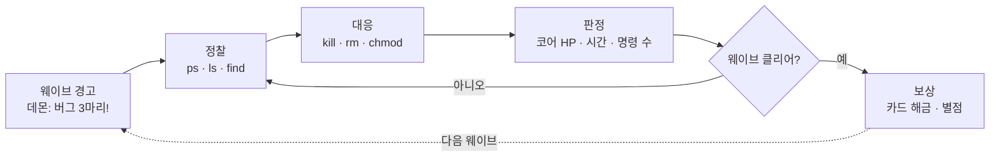
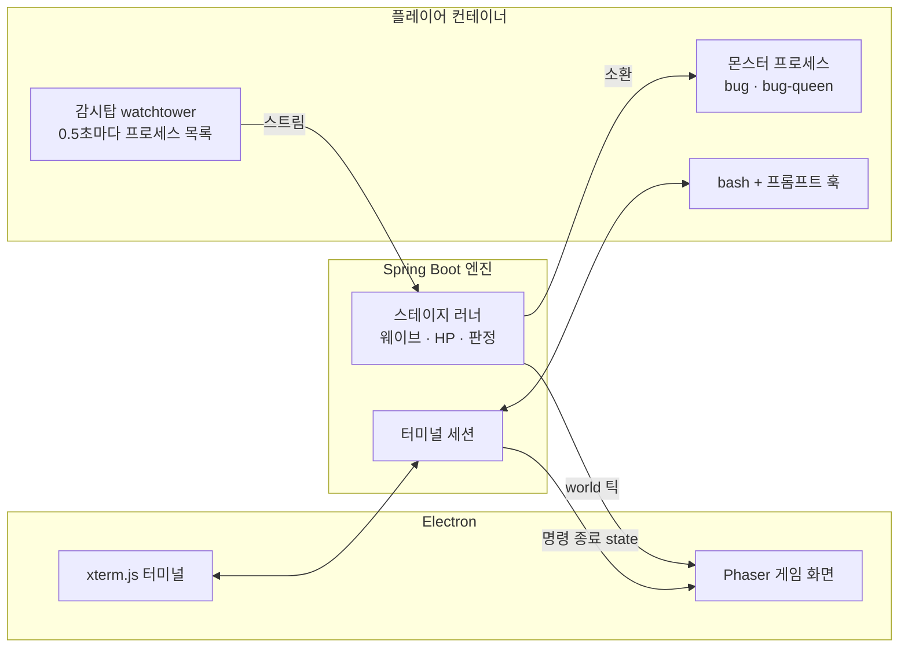

# DotShell — 서버 왕국 수호 RPG 기획서 v2

2026-11-26 · 종민

**한 줄 소개:** 진짜 우분투 터미널로 주문을 외워, 서버 왕국에 쳐들어오는 버그와 좀비를 물리치는 도트 RPG.

## v1에서 무엇이 바뀌었나

v1은 "명령어를 치면 방이 바뀐다"는 **파일 탐색기 시각화**에 가까웠다. 위협도, 시간 압박도, 주인공의 행동도 없어서 게임성이 약했다. v2는 다음 세 가지를 더한다.

| | v1 | v2 |
|---|---|---|
| 목표 | 방을 찾아 들어가기 | **서버 코어를 지키며** 던전을 탐험하기 |
| 적 | 없음 | **진짜 프로세스·파일이 몬스터** (kill로 처치) |
| 압박 | 없음 | 몬스터가 실시간으로 코어에 다가옴, 코어 HP |
| 주인공 | 서 있기만 함 | 타이핑하면 룬을 영창하고, Enter를 치면 시전·공격 |
| 탐험 | 다 보임 | 안개. `ls`로 밝히고 `ls -a`로 숨은 보물 발견 |
| 성장 | 없음 | 명령어 카드 해금, 별점, 후반엔 스크립트 포탑 |

**바뀌지 않는 원칙:** 게임용 가짜 명령어는 없다. 모든 명령은 Docker 컨테이너의 진짜 bash에서 실행되고, 게임은 그 결과(시스템 상태)를 읽어서 그린다.

## 명령어 선정 원칙: 실무에서 자주 쓰는 것만

이 게임의 목적은 **터미널을 손에 익히는 것**이다. 그래서 게임 진행에 필요한 명령어는 실무에서 매일 쓰는 것으로만 고르고, 쓰는 방법(옵션 조합)도 실무에서 실제로 치는 형태를 그대로 쓴다.

| 상황 (실무) | 게임에서의 상황 | 명령어 |
|---|---|---|
| 서버에 접속해서 위치 확인, 파일 둘러보기 | 방을 밝히고 이동 | `pwd`, `ls -al`, `cd`, `cat`, `less` |
| 파일 정리 | 물건 만들기·옮기기·부수기 | `mkdir -p`, `touch`, `cp -r`, `mv`, `rm -r` |
| 프로세스가 멈췄거나 폭주할 때 | 버그 몬스터 처치 | `ps aux`, `ps -ef \| grep`, `kill`, `kill -9`, `pkill`, `top` |
| 로그에서 에러 찾기 | 로그 홍수, 침입자 추적 | `tail -f`, `grep -r`, `find -name`, `du -sh`, `\|` |
| 권한 문제 | 잠긴 함정 | `ls -l`, `chmod`, `chown`, `sudo` |
| 협업 | 시간의 탑, 원격 성 | `git status/add/commit/push/pull/switch/merge/log` |
| 배포 | 구름 왕국 | `ssh`, `scp`, `aws s3 cp`, `aws ec2 describe-instances` |

게임 전용 장치(몬스터 실행 파일, 균열, 감시탑)는 **명령의 대상**일 뿐이고, 플레이어가 치는 명령은 항상 위 표의 진짜 명령이다. 예를 들어 `kill`은 실무에서 "멈춘 서버 프로세스를 PID로 찾아 끄는" 가장 흔한 명령이고, 게임에서도 똑같이 `ps aux`로 PID를 찾아 `kill <PID>`로 끈다.

## 핵심 컨셉: 진짜 시스템 상태가 곧 적이다

DotShell만 할 수 있는 것은 **컨테이너 안에서 실제로 벌어지는 일을 적으로 만드는 것**이다.

```
버그    = 진짜 프로세스 (ps 에 "bug" 로 보임)     → kill / pkill 로 처치
여왕    = 자식 버그를 계속 낳는 부모 프로세스     → pstree 로 부모를 찾아 처치
좀비    = 진짜 좀비 프로세스 (상태 Z)             → 부모를 정리해야 사라짐
홍수    = 계속 커지는 진짜 로그 파일              → du 로 찾고 truncate, 원인 처치
침입자  = 여러 폴더에 퍼지는 진짜 파일            → find / grep 으로 추적해 rm
함정    = 권한이 잠긴 진짜 파일                   → chmod 로 해제
```

몬스터는 게임 엔진이 컨테이너에 띄운 **이름 붙은 실행 파일**이다. 플레이어가 `ps aux`를 치면 정말로 `bug` 프로세스가 보이고, `kill 4231`을 치면 정말로 죽는다. 게임 밖 실무 서버에서도 똑같이 통한다.

## 핵심 게임 루프



실패해도 컨테이너만 다시 만들면 되므로 "죽고 다시 도전"하는 로그라이크 감각이 생긴다.

## 전투: 정보가 곧 무기

- **PID는 처음엔 안 보인다.** 몬스터 머리 위에는 `?`만 떠 있다. `ps`나 `top`을 치면 정찰 파동이 퍼지면서 PID 꼬리표가 붙는다.
- **가족 관계도 숨겨져 있다.** `pstree -p`나 `ps -ef --forest`를 치면 여왕과 새끼 사이에 연결선이 그려진다.
- **처치 방법이 여러 개다.** `kill PID`(정밀 사격), `pkill bug`(광역 마법), `kill -9`(강제 처치)를 상황에 맞게 고른다.
- **파이프는 연계기다.** `ps aux | grep bug | awk '{print $2}' | xargs kill`처럼 길게 이을수록 콤보 연출이 커진다.

### 위협 설계

| 위협 | 실제 리눅스 | 배우는 명령어 | 연출 |
|---|---|---|---|
| 버그 | `bug` 프로세스 | `ps`, `kill`, `pkill` | 초록 딱정벌레가 코어로 기어감 |
| 버그 여왕 | 자식을 낳는 부모 프로세스 | `pstree`, `ps -ef --forest`, PPID | 왕관 쓴 버그, 몇 초마다 새끼 생성 |
| 좀비 | 상태 `Z` 프로세스 | `ps`의 STAT, 부모 처리 | 회색 유령, 직접 때려도 안 죽음 |
| 로그 홍수 | 커지는 로그 파일 | `du -sh`, `find -size`, `truncate` | 방에 물이 차오름 |
| 침입자 | 퍼지는 파일 | `find -name`, `grep -r`, `rm` | 벽 틈으로 기어 나오는 쥐 |
| 잠긴 함정 | 권한 없는 파일 | `ls -l`, `chmod` | 붉은 자물쇠 상자 |

## 탐험: 안개와 밝히기

| 명령어 | 연출 |
|---|---|
| `cd` | 주인공이 문으로 걸어가 들어감, 새 방은 어둠 속 |
| `ls` | 횃불이 켜지며 방 안 물건이 드러남 |
| `ls -a` | 숨겨진 보물 상자가 반짝이며 등장 |
| `tree` | 지도 두루마리가 펼쳐지며 미니맵이 채워짐 |
| `find` | 레이더 파동, 먼 방의 목표에 핑 |
| `cat` | 두루마리를 펼쳐 읽음 |

## 연출: 화면이 살아 있게

- **영창:** 터미널에 글자를 칠 때마다 룬 문자가 주인공 머리 위로 떠오른다.
- **시전:** Enter를 치면 주인공이 빛나고, 명령이 성공하면 초록 마법진, 실패하면 주인공이 휘청이며 `!`가 뜬다.
- **타격감:** 처치하면 주인공이 무기를 던진다. `kill`은 단검 한 자루, `pkill`처럼 여럿이 죽으면 단검을 연사, 여왕은 대검. 포물선 비행과 잔상 → 명중 시 붉게 번쩍·찌그러짐·넉백·타격 불꽃 → 짧은 히트스톱 → 폭발과 해골, `PID 4231 종료`, 화면 흔들림, 콤보 카운터.
- **균열 문:** 몬스터는 화면 오른쪽의 큰 균열(32×36 도트 돌 아치, 안쪽 소용돌이 애니메이션)에서 나온다. 웨이브가 시작되면 붉은 섬광과 함께 흔들리며 열린다.
- **HUD:** 코어 HP 하트, 웨이브 표시, 데몬의 말풍선.
- **명령어 주문서:** 배운 명령어 카드는 오른쪽 패널에 늘어놓지 않고, **F1(또는 버튼)으로 여는 주문서 팝업**에 모은다. 열어 둔 채로 터미널 입력을 계속할 수 있다. 새 카드를 얻으면 알림과 NEW 표시가 뜬다.

## 성장

- **명령어 카드:** 새 위협이 나올 때마다 그것을 막는 명령어 카드를 해금한다. 오른쪽 패널에 카드로 쌓인다.
- **별점:** ★ 클리어, ★ 코어 HP 70% 이상, ★ 명령 수 기준 이하.
- **주문서 제작 (중반):** `.bashrc`에 `alias`나 함수를 직접 써서 나만의 스킬을 만든다.
- **포탑 (후반):** 셸 스크립트와 `cron`으로 버그를 자동으로 잡는 포탑을 세운다. 실무 자동화를 게임으로 배운다.

## 챕터와 보스

각 챕터는 튜토리얼 → 웨이브 스테이지 3~5개 → 보스 순서다.

| 챕터 | 배경 | 배우는 명령어 | 보스 |
|---|---|---|---|
| 1. cd 던전 | 지하 마을과 동굴 | `pwd ls cd mkdir touch cat cp mv rm find ps kill pkill` | **버그 여왕**: 새끼를 낳는 부모 프로세스 |
| 2. sudo 퀘스트 | 성 내부 | `chmod chown sudo apt grep \| > >> pstree` | **폭주 데몬**: root 소유라 `sudo` 없이는 못 잡음, 2페이즈 좀비화 |
| 3. Git Out! | 시간의 탑 | `init status add commit log diff branch switch merge restore reflog` | **시간 도둑**: 커밋을 지움 → `git reflog`로 되찾아 반격 |
| 4. 원격 성 | 하늘의 성 | `clone remote push pull fetch .gitignore`, PR | **라이벌 관리자**: 엔진이 실제로 Gitea에 push하며 충돌을 만듦 |
| 5. 구름 왕국 | 구름 위 섬 | `aws s3 · ec2 · iam`, `ssh` | **과금 드래곤**: EC2를 계속 소환, 모두 찾아 terminate |

자유 모드(샌드박스)에서는 몬스터를 직접 소환하고 마음대로 실험할 수 있다.

## 화면 구성

```
┌──────────────────────────────────────────────────────┬─────────────────┐
│ ♥♥♥♥♡  WAVE 2/3   1-1 버그 습격                         │ 퀘스트          │
│ 🌲🌲🌲🌲🌲🌲🌲🌲🌲🌲🌲🌲🌲🌲🌲🌲🌲🌲🌲                     │ · 코어를 지켜라  │
│  🚪hall/  🚪vault/  📜key.txt  ?  ?   (안개)        │ · 웨이브 2/3    │
│                                                      ├─────────────────┤
│  💎코어  🧙(ᚲᛁᛚᛚ) 🗡→  🪲4231  🪲?  🪲?  ← 🌀 균열    │ 데몬의 말       │
│        👻 데몬: "pkill bug 로 한 번에!"               │                 │
│                     HIT!  💥 COMBO x2                 │ 명령 기록       │
├──────────────────────────────────────────────────────┴─────────────────┤
│ hero@dotshell:~$ pkill bug                                              │
└─────────────────────────────────────────────────────────────────────────┘
```

## 아트 방향

### 기준 에셋

[Kenney Monochrome RPG / Pirates](https://kenney.nl) (CC0, 상업 이용 가능, 크레딧 선택). `assets/` 폴더에 원본이 있다.

| 팔레트 | 색 | 쓰임 |
|---|---|---|
| L0 | `#B5B0DD` | 가장 밝은 바탕 |
| L1 | `#8E8BB7` | 밝은 중간 |
| L2 | `#666389` | 어두운 중간 |
| L3 | `#44415D` | 외곽선 |

### 가시성 규칙: 환경은 보라, 행동하는 것은 색

원본은 4색 단색이라 캐릭터가 배경에 묻힌다. 그래서 다음 규칙으로 색을 입힌다.

- **환경(땅, 나무, 동굴, 길):** 원본 보라색 그대로 둔다. 분위기를 지킨다.
- **행동하는 것과 상호작용 대상(주인공, 데몬, 몬스터, 아이템, 문, 코어, 하트):** 배경을 투명하게 따고, 4단계 명도를 그대로 유지한 채 **고유 색 램프**로 바꾼다. 발밑에 그림자를 깐다.

| 대상 | 색 램프 (밝음 → 외곽선) | 의미 |
|---|---|---|
| 주인공 | 크림 → 하늘 → 파랑 → 남색 | 나 |
| 데몬(힌트 요정) | 흰색 → 하늘색 → 청록 → 남색 | 아군 |
| 버그 | 연두 → 초록 → 진초록 → 검정 | 적 (약함) |
| 버그 여왕 | 분홍 → 자홍 → 보라 → 검정 + 금색 왕관 | 적 (강함) |
| 서버 코어 | 흰색 → 청록 → 짙은 청록 → 남색 | 지켜야 할 것 |
| 문(디렉터리) | 밝은 나무 → 나무 → 짙은 나무 → 고동 | 이동 |
| 두루마리(파일) | 종이 → 누런 종이 → 갈색 글씨 → 고동 | 읽기 |
| 열쇠·보물 | 금색 계열 | 목표 |
| 하트 | 빨강 계열 | 체력 |

### 추가 에셋 제작 규칙

Kenney 팩에 없는 것(버그, 여왕, 코어, 두루마리 등)은 직접 만들되 같은 느낌을 지킨다.

- 16×16, 원본 4색 팔레트로 먼저 그리고 위 규칙대로 색 램프를 입힌다.
- 외곽선은 L3, 1픽셀. 좌우 대칭 캐릭터는 왼쪽 절반만 그리고 미러링한다.
- 원본은 `client/tools/sprites.mjs`의 픽셀 맵과 Kenney 타일 번호이며, 생성된 PNG는 `client/src/renderer/assets/sprites/`에 있다. Pixelorama·Aseprite로 PNG를 직접 고쳐도 된다.

## 기술 설계

v1의 구조(Electron + Spring Boot 엔진 + 플레이어 Docker 컨테이너, PROMPT_COMMAND 신호)는 그대로 두고, 다음을 더한다.



- **몬스터 = 이름 붙은 실행 파일:** `/usr/local/lib/dotshell/monsters/bug`는 `sleep`을 복사한 것이라 `ps`에 `bug`로 보이고 `pkill bug`로 잡힌다. 여왕은 자식 버그를 낳는 bash 스크립트다.
- **균열(rift):** 컨테이너의 첫 프로세스(root)다. 엔진이 FIFO(`/run/dotshell/rift`)에 몬스터 이름을 쓰면 균열이 그 몬스터를 `hero` 소유의 자식으로 띄운다. `docker exec`로 띄우면 부모가 컨테이너 밖(PPID 0)이라 `pstree`에 안 보이기 때문이다. 플레이어는 root 소유인 균열을 끌 수 없다.
- **감시탑:** 컨테이너 안에서 root로 도는 작은 스크립트가 0.5초마다 프로세스 목록을 출력하고, 엔진이 그 스트림을 읽는다. 매번 `docker exec`를 만들지 않아도 된다.
- **스테이지 러너:** 엔진이 웨이브 소환, 몬스터 진행도, 코어 HP, 승패, 별점을 계산해 `world` 메시지로 보낸다. 판정은 항상 서버가 한다.
- **스테이지 파일:** `engine/src/main/resources/stages/*.json` (몬스터 종류, 이동 시간, 피해량, 웨이브, 힌트, 해금 카드). 스테이지를 늘릴 때 코드를 건드리지 않는다.
- **좀비 처리:** 컨테이너를 `--init`으로 띄워 PID 1이 고아 프로세스를 거둔다. 좀비는 의도할 때만 만든다(챕터 2).
- **DB:** 진행도 저장은 PostgreSQL (Docker 컨테이너).

### 웹소켓 메시지 (추가분)

| 방향 | type | 내용 |
|---|---|---|
| 엔진 → 클라이언트 | `world` | 0.5초마다. phase, wave, hp, monsters[pid, ppid, kind, progress, attacking] |
| 엔진 → 클라이언트 | `announce` | 데몬 대사, 해금 카드 |
| 엔진 → 클라이언트 | `result` | victory/defeat, 시간, 명령 수, 별점 |
| 클라이언트 → 엔진 | `restart` | 스테이지 다시 시작 |

## 첫 스테이지 상세: 1-1 버그 습격

| 웨이브 | 등장 | 데몬의 힌트 | 해금 카드 |
|---|---|---|---|
| 1 | 버그 2마리 (천천히) | "`ps`로 정찰하고 `kill <PID>`로 잡아!" | `ps`, `kill` |
| 2 | 버그 5마리 (빠르게 연달아) | "많다! `pkill bug`로 이름으로 한 번에!" | `pkill` |
| 3 | 버그 여왕 | "새끼만 잡으면 또 나와! `pstree -p`로 부모를 찾아." | `pstree` |

별점: 클리어 / 코어 HP 70% 이상 / 명령 8개 이하.

## 참고한 게임

| 게임 | 빌려온 것 |
|---|---|
| Oh My Git! | 진짜 도구를 쓰는 레벨, 레벨을 파일로 정의 |
| Learn Git Branching | 결과를 즉시 그림, 최소 명령 점수(별점) |
| OverTheWire Bandit | 실제 서버 감각, 답을 찾아야 다음 문이 열림 |
| 타워 디펜스 장르 | 웨이브, 코어 HP, 포탑(후반 cron 스크립트) |

## 개발 로드맵 v2

1. ~~프로토타입: Electron + 엔진 + 컨테이너 연결~~ (완료)
2. ~~세로 조각: 1-1 버그 습격 한 판~~ (완료) 균열·감시탑, 스테이지 러너, Phaser 화면, 채색 스프라이트, 영창·무기 투척 연출, 주문서(F1)
3. **마을(다음):** 디렉터리 구조가 곧 마을 지도. 집·광장·창고가 디렉터리이고, `cd`를 치면 주인공이 그 건물까지 **걸어가서** 들어가고, `ls`는 횃불을 켜고, `cat`은 표지판을 읽는다. 전투 스테이지는 마을의 균열에서 열린다.
4. cd 던전 나머지: 안개·탐험 스테이지, 미믹 보스, 스테이지 선택 화면
5. sudo 퀘스트: 권한·좀비·로그 홍수, 진행도 저장(PostgreSQL)
6. Git Out!, 원격 성 (Gitea)
7. 구름 왕국 (Floci, 서버 섬)
8. exe 배포: Electron 빌드 + jpackage로 엔진 동봉

## 정해야 할 것

- [ ] 제목 확정 (DotShell)
- [ ] 효과음·배경음 (무료 CC0 사운드 사용 여부)
- [ ] 난이도 곡선: 웨이브 속도를 타자 속도에 맞춰 조절할지
- [ ] 첫 공개 범위: 챕터 1까지 낼지
